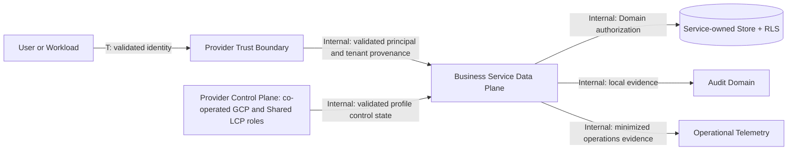
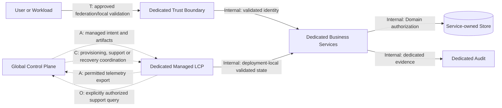
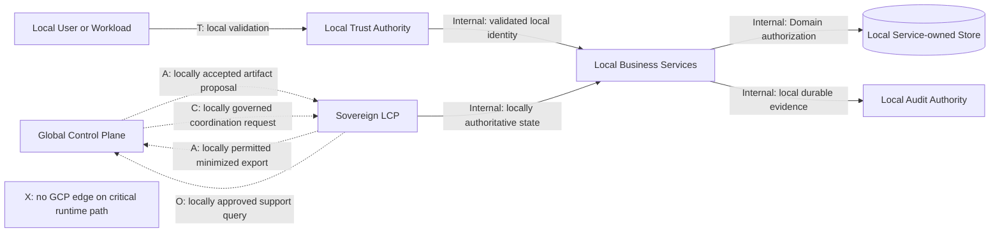

# V3-020: Global and Local Control Plane Ownership Matrix

- Task: `V3-020 — Define global vs local control-plane boundaries`
- Phase / review gate: `P02 / R2`
- Architecture baseline: `NESHANE-V3-ARCH-P00-005`
- Document status: `ACCEPTED — R2 CONTROL PLANE OWNERSHIP DESIGN BASELINE`
- Task status: `CLOSED — R2 DESIGN BASELINE`
- R2 disposition: `ACCEPTED — CONTROL PLANE OWNERSHIP DESIGN BASELINE`
- Acceptance authority: Technical Architecture Owner
- Acceptance source: explicit Technical Architecture Owner decision for Task V3-020
- User revalidation: `PASSED`
- Accepted design-content SHA-256 before acceptance metadata: `8667ff4d6809bbed882fef6973537c371f10303cbd187ebb1d3bda5c08d30257`
- Decision authority: Technical Architecture Owner
- Runtime implementation: Not in scope

This document is the single V3-020 ownership-matrix deliverable. It refines the
accepted architecture without changing an accepted ADR. The bounded design
statements marked `R2-ACCEPTED` are accepted only within the scope and explicit
non-goals recorded here; implementation and release evidence remain independent.

## 1. Purpose and scope

The purpose is to make authority, trust and dependency boundaries explicit for
the Shared SaaS, Dedicated Managed and Dedicated Sovereign profiles. It covers
control-plane ownership and the relationship between management intent and
runtime enforcement. It does not select control-plane products, synchronization
protocols, credential technology or deployment orchestration.

The prerequisite baselines are satisfied for design work:

- `V3-003` is `CLOSED — ANALYTICAL SCOPE ONLY`; its security review,
  implementation and negative-test gates remain independent.
- `V3-004` is `CLOSED — FIRST RELEASE SUPPORT MATRIX DESIGN BASELINE ONLY`.
- The effective Root architecture baseline is
  `NESHANE-V3-ARCH-P00-005`, established by the traceable DEC-015/ADR-V3-015
  commit.

### Classification used in this document

| Marker | Meaning |
| --- | --- |
| `APPROVED` | Restatement of an accepted ADR or existing approved baseline. |
| `R2-ACCEPTED` | V3-020 bounded design accepted by the Technical Architecture Owner. |
| `OPEN` | Governed by an unresolved Open Decision or missing authority decision. |
| `DEFERRED` | Implementation detail intentionally assigned to a later task. |

## 2. Terminology and trust domains

| Term | Definition |
| --- | --- |
| Global Control Plane (`GCP`) | Provider-level management capabilities for catalog, commercial coordination, profile provisioning and permitted fleet visibility. Visibility does not confer mutation or runtime authority. |
| Local Control Plane (`LCP`) | The management authority inside a deployment profile's trust and operational boundary. In Shared SaaS it can be co-operated with GCP; in Dedicated Managed it is scoped to the dedicated deployment; in Dedicated Sovereign it is finally authoritative. |
| Data Plane (`DP`) | Business APIs, events, hooks, jobs and persistence that enforce authenticated Tenant Context and resource-owning Domain authorization. |
| Authority record | The record whose owner may make the governed decision. A cached or synchronized copy is not an authority record. |
| Critical runtime path | A path required to authenticate or authorize an approved local operation, resolve its tenant, execute it, record required local Audit evidence, or recover the local service. |
| Placement Generation | A monotonic tenant-placement version used to reject stale routing or placement state. Its representation and migration protocol are deferred. |
| Trust validation edge | A dependency used to validate identity, workload or signed evidence. Network location alone is never trust. |
| Commercial entitlement | Evidence that a product/capability may be licensed. It is not a user, operator, plugin or resource permission. |
| Grant | Scoped authorization evidence for a Principal or Plugin Installation. The resource-owning service still makes the final resource/action decision. |

The relevant trust domains are: provider/global management, each deployment's
local management boundary, each workload/service boundary, each tenant boundary,
each resource-owning Domain, plugin execution, and external federation/support.

## 3. Ownership principles

1. **APPROVED — stable tenant identity:** Tenant identity is independent of
   cell, database and physical placement. Topology must not be encoded in the
   Tenant ID.
2. **APPROVED — final Domain authorization:** Authentication, Membership,
   Entitlement and authorization are distinct. A resource-owning Business
   Service makes the final resource/action decision.
3. **APPROVED — tenant defense in depth:** Tenant Context is established only
   from authenticated validated provenance; invalid or conflicting context
   fails closed. Shared tenant-aware persistence retains tenant constraints,
   non-bypass roles and PostgreSQL RLS.
4. **APPROVED — sovereign local authority:** Dedicated Sovereign has locally
   authoritative trust, secrets, policy, grants, Audit, plugin lifecycle,
   recovery and credential lifecycle. GCP has no implicit local administrative
   right and is not a mandatory dependency for critical runtime operations.
5. **APPROVED — service and evidence ownership:** Services own their data and
   contracts. A synchronized management copy cannot overwrite Domain truth or
   required Audit evidence.
6. **R2-ACCEPTED — explicit authority metadata:** Every synchronized control record
   carries an authority scope, profile/deployment identity, semantic version or
   generation, issue time, applicable freshness/expiry data and provenance.
7. **R2-ACCEPTED — no silent conflict winner:** A lower or unknown generation,
   invalid provenance, incompatible semantics or authority-scope mismatch is
   rejected or quarantined. Reconciliation preserves both views and an Audit
   trail; GCP never silently wins.
8. **R2-ACCEPTED — bounded degradation:** Loss of a non-authoritative plane cannot
   turn a previously denied operation into an allowed operation. An affected
   operation fails closed when locally required authority or integrity evidence
   cannot be established.

## 4. Full capability ownership matrix

Each sub-scope below names one logical authority. Physical co-deployment or a
shared operator does not merge those authorities. Replication, validation and
runtime enforcement are stated separately and never create write authority.
Ownership below is R2-accepted unless the traceability cell identifies an
earlier accepted invariant or an explicitly open/deferred detail.

| # | Capability | Authoritative owner by profile (Shared / Managed / Sovereign) | Runtime enforcement and read/write boundary | Required cross-plane interaction | Partition, revocation and recovery behavior | Governance |
| --- | --- | --- | --- | --- | --- | --- |
| 1 | Tenant Registry and stable Tenant ID | Stable-ID/active-registry scope — Shared: **Provider Tenant Registry Authority**; Managed: **Global Managed Tenant Registry Authority**; Sovereign: **Sovereign Tenant Registry Authority** after explicit local import. | The named Registry Authority alone writes its registry. Managed LCP holds a read-only validated replica; Sovereign treats a global provisioning artifact only as input. D resolves Tenant through locally validated state. | Shared: `N/A` — no separate cross-plane edge. Managed: `A` — registry snapshot GCP → LCP; `C` — initial provisioning/conflict disposition. Sovereign: `C` — provisioning proposal GCP → LCP; `A` — optional catalog status LCP → GCP. | Existing locally validated identities remain resolvable; creation/import requires the named authority. Unknown or conflicting identity fails closed. | ADR-003; ADR-004; `R2-ACCEPTED` handover semantics. |
| 2 | Tenant lifecycle and suspension | Runtime-effective lifecycle scope — Shared: **Provider Tenant Lifecycle Authority**; Managed: **Global Managed Tenant Lifecycle Authority**; Sovereign: **Sovereign Tenant Lifecycle Authority**. Commercial-account scope remains separately owned by **Product Authority** and is not permission. | The Lifecycle Authority writes technical lifecycle state; the profile LCP activates validated state and D enforces it. Product Authority writes only commercial status. | Shared: `N/A`. Managed: `A` — lifecycle state GCP → LCP; `C` — conflict/exception disposition. Sovereign: `A` — commercial or suspension notice GCP → LCP; `C` — locally authorized disposition when policy requires review. | Locally known effective suspension denies affected access. Instant effect of a central-only notice during disconnection is not claimed; freshness/effect policy is `OPEN`. | ADR-003/004/005; OD-009/010/023. |
| 3 | Cell Registry and Tenant Placement | Placement scope — Shared: **Provider Placement Authority**; Managed: **Global Managed Placement Authority**; Sovereign: **Sovereign Placement Authority**. | The named Placement Authority alone writes assignment/generation. The profile router and destination D validate Tenant plus the locally activated generation. | Shared: `N/A`. Managed: `A` — placement intent GCP → LCP; `C` — migration coordination. Sovereign: `A` — optional placement proposal GCP → LCP; `C` — locally approved migration coordination; `X` — GCP runtime placement lookup. | Stale/lower generation is rejected. Existing valid local placement can operate; new move or unresolved conflict stops. Migration automation is `OPEN`. | ADR-003; OD-015/022/023. |
| 4 | Trust authorities and cryptographic keys | Trust-admission/key-custody scope — Shared: **Provider Trust Authority**; Managed: **Dedicated Managed Trust Authority**; Sovereign: **Sovereign Trust Authority**. | The named Trust Authority alone mutates its trust store and controls private-key custody. Workloads validate locally; replicas never obtain custody authority. | Shared: `N/A`. Managed: `A` — approved public trust bundle GCP → Dedicated Trust Authority; `C` — governed rotation ceremony. Sovereign: `A` — locally approved public trust bundle GCP → Sovereign Trust Authority; `C` — governed local import/rotation; `X` — private-key export or central online validation on a critical path. | Missing, expired or locally known revoked trust fails closed. GCP cannot replace or extract Sovereign private keys. | ADR-004/005/010; OD-011/012. |
| 5 | Identity and workload trust | Issuer-admission scope — Shared: **Provider Trust Authority**; Managed: **Dedicated Managed Trust Authority**; Sovereign: **Sovereign Trust Authority**. Credential-assertion scope: the single **Admitted Identity Issuer** identified by validated issuer metadata for that credential. | Trust Authority alone admits/removes issuers. The Admitted Identity Issuer is authoritative only for its credential assertions; every D validates issuer, audience, expiry and required claims, then performs Domain authorization. | Shared: `N/A`. Managed: `A` — approved issuer metadata GCP → Dedicated Trust Authority; no synchronous cross-plane validation is selected by this baseline. Sovereign: `A` — locally approved issuer metadata GCP → Sovereign Trust Authority; `X` — central runtime identity validation on a critical path. | Cached evidence is usable only within approved lifetime/revocation rules. Exact session, workload identity and disconnected revocation semantics are `OPEN`; future identity decisions must classify any new edge. | ADR-004/005; OD-009/010/011. |
| 6 | Platform and local policies | Common-policy-contract scope: **Shared Policy Governance**. Activation scope — Shared: **Shared Policy Activation Authority**; Managed: **Dedicated Managed Policy Activation Authority**; Sovereign: **Sovereign Policy Authority**. Resource-rule scope: each **resource-owning Domain**. | Shared Policy Governance writes the common contract; the profile Activation Authority activates a validated version; each D owns and enforces resource rules. No policy can disable mandatory security invariants. | Shared: `N/A`. Managed: `A` — policy artifact GCP → Dedicated Policy Activation Authority; `C` — exception/conflict disposition. Sovereign: `A` — policy proposal GCP → Sovereign Policy Authority; `C` — local approval/conflict disposition; `X` — remote policy activation by GCP. | Incompatible or stale policy does not overwrite the active local version. Missing required policy fails the affected decision closed. | ADR-004/005; `R2-ACCEPTED` version/conflict rules. |
| 7 | Product entitlements and offline license verification | Commercial-evidence scope: **Product Entitlement Authority**. Eligibility-activation scope — Shared: **Shared Entitlement Eligibility Authority**; Managed: **Dedicated Managed Entitlement Eligibility Authority**; Sovereign: **Sovereign Entitlement Eligibility Authority**. Permission scope: each **resource-owning Domain**. | Product Authority issues commercial evidence; profile Eligibility Authority validates/activates it; D separately authorizes resources/actions. No replica or entitlement issuer grants permission. | Shared: `N/A`. Managed: `A` — versioned entitlement evidence GCP → Dedicated Eligibility Authority; `C` — commercial exception coordination. Sovereign: `A` — versioned entitlement evidence GCP → Sovereign Eligibility Authority; `C` — locally governed exception coordination; `X` — GCP runtime eligibility lookup. | Expiry, grace, refresh and disconnected renewal are `OPEN`; no perpetual or numeric offline guarantee is created. Invalid evidence cannot become permission. | ADR-004/005; OD-001/023; Product authority required. |
| 8 | Administrative and user Grants | Platform/admin-grant scope — Shared: **Shared Platform Grant Authority**; Managed: **Dedicated Managed Grant Authority**; Sovereign: **Sovereign Grant Authority**. Resource-grant scope: each **resource-owning Domain**. Plugin Installation-grant scope: the profile's **Plugin Control Plane**. | Each named Grant Authority alone writes its scope. Destination D performs final resource/action authorization. Plugin grants remain Installation- and Tenant-bound. | Shared: `N/A`. Managed: `A` — optional grant-status visibility LCP → GCP; `C` — managed grant request, with LCP decision. Sovereign: `A` — optional grant-status visibility LCP → GCP; `C` — locally approved support request; `X` — GCP grant mutation or authorization. | Known revocation fails closed. Grant cache freshness and in-flight semantics remain governed design gaps; emergency access cannot bypass Domain authorization/Audit. | ADR-004/005/006; V3-003-DEC-008 principles; OD-010/016. |
| 9 | Application admission and Client Registration | Admission scope — Shared: **Shared Admission Authority**; Managed: **Dedicated Managed Admission Authority**; Sovereign: **Sovereign Admission Authority**. | The named Admission Authority registers a client/workload for its trust domain. D still validates identity/audience and authorizes the operation. Catalog replicas cannot admit. | Shared: `N/A`. Managed: `A` — approved client/artifact catalog GCP → Dedicated Admission Authority; `C` — admission request. Sovereign: `A` — approved artifact/catalog proposal GCP → Sovereign Admission Authority; `C` — local admission request; `X` — runtime registration against GCP. | Unknown, revoked or scope-mismatched client fails closed. Protocol and credential mechanisms remain `OPEN`. | ADR-004/005/008; OD-007/009/011/012. |
| 10 | Deployment, operations and support authority | Infrastructure-operation scope — Shared: **Provider Operations Authority**; Managed: **Dedicated Managed Operations Authority**; Sovereign: **Sovereign Operations Authority**. Destination business-operation scope remains with each **resource-owning Domain**. | Operations Authority changes infrastructure with scoped identity. Destination D authorizes sensitive Domain actions. Support identity has no independent write authority. | Shared: `N/A`. Managed: `A` — release/operational intent GCP → Dedicated Operations Authority; `C` — support/recovery coordination. Sovereign: `A` — locally accepted release artifact proposal GCP → Sovereign Operations Authority; `C` — locally initiated support; `X` — GCP emergency execution or implicit administration. | Sovereign Operations Authority owns restart/rollback/recovery. No global support identity has implicit access. Runtime tooling is `OPEN`. | ADR-004/010/011/012; OD-015/023. |
| 11 | Audit evidence and operational telemetry | Business-fact scope: each **producing Domain**. Authoritative Audit-record scope: the profile's **Audit Domain**. Operational-telemetry scope: the profile's **Observability Authority**. | Producing D writes owned Business Facts/obligations; Audit Domain owns authoritative Audit records; Observability Authority owns minimized telemetry configuration. None may overwrite another scope. | Shared: `N/A` — required Audit and provider telemetry stay inside the co-operated profile. Managed: `A` — permitted telemetry LCP → GCP; `O` — explicitly authorized support query. Sovereign: `A` — locally permitted minimized export LCP → GCP; `O` — locally approved support query; `X` — central Audit acknowledgement as local success or telemetry command backchannel. | Export loss cannot erase local Audit obligations. Missing required local Audit authority follows approved operation-specific semantics; executable DURABLE_DEFER remains unapproved. | ADR-004/007/010; V3-003-DEC-010/011/014 principles. |
| 12 | Recovery and emergency administrative access | Infrastructure-recovery scope — Shared: **Provider Recovery Authority**; Managed: **Dedicated Managed Recovery Authority**; Sovereign: **Sovereign Recovery Authority**. Durable Domain-evidence scope remains with its **owning Domain**; emergency business-action authorization remains with the **destination Domain**. | Recovery Authority orchestrates infrastructure recovery; owning Domain supplies authoritative evidence; destination D authorizes business effects. No support or replica becomes an evidence owner. | Shared: `N/A`. Managed: `A` — approved recovery artifact/status exchange; `C` — recovery coordination. Sovereign: `A` — locally accepted recovery artifact proposal GCP → Sovereign Recovery Authority; `C` — locally initiated assistance; `X` — central restore, re-drive or emergency action without local authorization. | The profile Recovery Authority decides infrastructure restore; Domain owners decide evidence correction/re-drive effects. No automatic restoration, generic break-glass authority or central override is approved. | ADR-004/007/010/012; V3-003-DEC-014; OD-012/015/023. |

## 5. Shared SaaS responsibility matrix

| Concern | GCP responsibility | LCP / Data Plane responsibility | Dependency and failure boundary |
| --- | --- | --- | --- |
| Tenant and placement | The Provider Tenant/Lifecycle/Placement Authorities own their distinct records. | Profile-local resolution, generation checks and Domain authorization. | `N/A` cross-plane: Shared GCP/LCP roles are co-operated logical functions. Internal required dependencies do not become cross-plane edges; no offline commitment exists. |
| Trust and admission | Provider Trust/Identity/Admission Authorities own their distinct scopes. | Services validate tokens/workloads and enforce audience, Tenant Context and authorization. | `N/A` cross-plane. Trust failure fails the affected path closed. |
| Policy, entitlement and grants | Product catalog and common policy governance own only their named scopes. | Profile Activation/Eligibility/Grant Authorities and Domains retain their separate scopes. | `N/A` cross-plane. Entitlement never implies permission. |
| Operations and evidence | Provider Operations/Recovery/Observability Authorities own their distinct scopes. | Services/Audit own business evidence; RLS and non-bypass runtime roles remain mandatory. | `N/A` cross-plane. A control-plane outage has no universal degraded-operation promise. |
| Emergency authority | Provider Recovery Authority may orchestrate infrastructure recovery. | Destination service authorizes sensitive action and records Audit evidence. | `N/A` cross-plane. No generic provider admin bypass. |

## 6. Dedicated Managed responsibility matrix

| Concern | GCP responsibility | Dedicated LCP / Data Plane responsibility | Dependency and failure boundary |
| --- | --- | --- | --- |
| Tenant and placement | Global Managed Tenant/Placement Authorities publish governed state. | Dedicated LCP holds validated replicas and enforces activated generations. | `A` state distribution; `C` provisioning/migration/conflict disposition. Management changes may wait for GCP; continued operation remains policy/evidence dependent. |
| Trust and admission | GCP distributes only approved public trust/client artifacts. | Dedicated Trust and Admission Authorities validate and activate them; services validate identity/audience. | `A` artifact distribution; `C` rotation/admission request. Dedicated network/location is not identity. |
| Policy, entitlement and grants | GCP distributes policy contracts and commercial evidence. | Dedicated Activation/Eligibility/Grant Authorities own their scopes; Domains make final decisions. | `A` artifact distribution; `C` exception/request. Invalid/stale evidence fails affected authorization; exact freshness is unresolved. |
| Operations and evidence | GCP publishes managed intent and receives permitted telemetry. | Dedicated Operations, Recovery, Audit and Domain Authorities retain their scopes. | `A` intent/evidence exchange; `C` support/recovery coordination; `O` explicitly authorized support query. Provider operations do not become universal Domain authority. |
| Emergency authority | GCP may submit a coordination request only. | Dedicated Recovery Authority executes infrastructure recovery; destination Domain authorizes business effects. | `C` request/coordination. No implicit global break-glass access. |

## 7. Dedicated Sovereign responsibility matrix

| Concern | GCP responsibility | Sovereign LCP / Data Plane responsibility | Runtime and disconnection rule |
| --- | --- | --- | --- |
| Tenant and placement | May submit a provisioning/placement proposal and receive optional catalog status. | Sovereign Tenant/Lifecycle/Placement Authorities retain final local scopes. | `C` provisioning/migration proposal; `A` optional status exchange; `X` runtime tenant/placement lookup. |
| Trust, identity and admission | May submit public trust, issuer or client artifacts for local consideration. | Sovereign Trust/Identity/Admission Authorities own custody, admission and validation. | `A` artifact proposal; `C` governed import/rotation; `X` central online validation on a critical path. |
| Policy, entitlement and grants | May submit policy and commercial-evidence proposals. | Sovereign Policy/Eligibility/Grant Authorities and Domains retain their separate scopes. | `A` artifact proposal; `C` local exception/conflict disposition; `X` remote activation, grant mutation or runtime eligibility lookup. |
| Application and plugins | Supplies compatible artifacts/contracts where locally approved. | Runs local applications, Extension Gateway, plugin lifecycle and Installation grants. | `A` artifact proposal; `C` governed admission/support request; `X` runtime callback to GCP for local authority. |
| Audit and telemetry | Receives only locally permitted minimized export or support response. | Producing Domains, local Audit and local Observability Authority own evidence. | `A` minimized export; `O` approved support query; `X` central acknowledgement as Audit success or telemetry command channel. |
| Operations and recovery | Provides artifacts or assistance only through locally governed paths. | Sovereign Operations/Recovery Authorities own release, restart, restore and emergency infrastructure action; Domains authorize business effects. | `A` artifact proposal; `C` locally initiated assistance; `X` central restore, re-drive, emergency execution or implicit administration. |

Dedicated Sovereign is offline-capable for explicitly approved critical local
operations, not automatically Air-Gapped. Full Air Gap remains `OD-001`.

## 8. Cross-plane dependency classification

| Code | Class | Allowed use | Authority and safety rule |
| --- | --- | --- | --- |
| `M` | Mandatory synchronous runtime dependency | Only when an approved profile contract explicitly requires cross-plane runtime communication. No `M` edge is selected by this V3-020 proposal. | Must not appear on a Dedicated Sovereign critical runtime path. Failure blocks only the operation that genuinely requires it. |
| `O` | Optional synchronous | Best-effort catalog, support or telemetry interaction. | Unavailability cannot expand authority or invalidate an otherwise locally authoritative decision. |
| `A` | Asynchronous synchronization | Versioned placement, policy, entitlement, trust bundle, catalog, telemetry or Audit export. | Receiver validates provenance, scope, generation/version, freshness and compatibility before activation. |
| `C` | Administrative coordination | Human-governed provisioning, migration, support, exception or recovery workflow. | Requires authenticated actors, explicit scope, approval evidence and Audit. It creates no ambient runtime right. |
| `X` | Prohibited dependency | Central authorization, tenant resolution, trust, Audit acknowledgement or admin callback on a Sovereign critical runtime path. | Design or runtime must reject the dependency rather than degrade silently. |
| `N/A` | No cross-plane edge | The activity is wholly internal to the profile or no interaction exists for that scope. | Internal dependencies still retain their own trust, authorization and failure controls; `N/A` must not hide a GCP↔LCP call. |

### R2-accepted synchronization contract

1. The sender identifies the source authority, deployment/profile, scope and
   semantic version or monotonic generation.
2. The receiver authenticates the sender and validates integrity, audience,
   scope, compatibility, freshness and local admission policy.
3. Lower, replayed, unknown, expired or conflicting evidence is rejected or
   quarantined. It is not silently promoted.
4. Conflict ownership follows the capability matrix. For Sovereign runtime,
   LCP authority remains effective while the conflict is unresolved. This does
   not imply an automatic `LOCAL_WINS` reconciliation result. The conflicting
   GCP view remains evidence, and reconciliation has no automatic
   `LOCAL_WINS`, `CENTRAL_WINS` or `LAST_WRITER_WINS` strategy.
5. Restart uses the last locally activated, durably stored and still-valid
   authority state. Absence or invalidity fails the affected operation closed.
6. Reconnection compares generations and provenance, preserves an Audit trail,
   and requires explicit conflict disposition. No last-write-wins rule is
   approved.
7. Numeric freshness windows, credential lifetimes, grace periods, retry
   schedules and transport/protocol choices are `OPEN` or `DEFERRED`.

## 9. Dependency graphs

### 9.1 Edge legend

- Solid arrow labelled `M`: mandatory synchronous cross-plane runtime edge.
- Solid arrow labelled `Internal`: required dependency wholly inside one
  profile; it is not a cross-plane interaction.
- Each dashed arrow has exactly one `A`, `O` or `C` classification.
- `T` label: trust-validation edge.
- An explicit `X` node records a prohibited edge; it is not an executable path.

### 9.2 Shared SaaS



### 9.3 Dedicated Managed



### 9.4 Dedicated Sovereign



Review rule: the Sovereign path from local Principal validation through Tenant
resolution, Domain authorization, persistence and required Audit evidence is
complete without traversing GCP.

## 10. Failure and disconnection scenarios

| Scenario | Shared / Managed R2-accepted behavior | Dedicated Sovereign R2-accepted behavior | Residual decision or evidence gap |
| --- | --- | --- | --- |
| A. GCP unreachable | Shared management-dependent actions can stop; Managed uses only still-valid local state and stops changes requiring GCP. No universal availability promise. | Approved critical local operations continue from valid local authority; global catalog, export and coordination queue or stop. | Operation catalog, duration and capacity; OD-023. |
| B. DNS/inter-domain network unavailable | Profile-local paths may operate if their required trust/authority is local; external dependencies fail by their contract. | No central DNS/inter-domain resolution is required for critical paths. Optional exchange stops. | Concrete network topology; OD-015. |
| C. Central trust service inaccessible | Shared uses its provider-profile trust boundary. Managed uses locally activated trust state; this proposal selects no central synchronous validation. Missing/invalid local trust fails the affected path closed. | Local trust roots and validation remain authoritative. Missing/invalid local trust fails the affected path closed. | OD-009..012 and numeric freshness; any future online validation edge requires an explicit decision/classification. |
| D. Central placement information stale | Local router rejects stale/lower generation; a placement change waits for reconciliation. | Local placement generation is authoritative. Central state cannot reroute local traffic or overwrite it. | Migration state machine; OD-022. |
| E. Global and Local configuration disagree | Capability authority in section 4 decides; incompatible update is rejected/quarantined and audited. | LCP remains final. Both views and provenance are preserved for governed reconciliation. | Detailed configuration schema and workflow deferred. |
| F. Revoked or suspended identity presented | A locally known revocation/suspension fails closed. Central-only revocation latency follows yet-unapproved credential/session freshness policy. | Same local rule; no claim of immediate knowledge of an unreachable central-only event. Local revocation authority remains available. | OD-009/010/011/023. |
| G. Local restart during disconnection | Managed restarts only from durable, valid profile-local authority; otherwise affected capabilities stop. | LCP/DP restart from durable local trust, tenant, placement, policy, entitlement and Audit state. Missing required state fails the affected capability closed. | Boot evidence, recovery runbooks, OD-012/015/023. |

The table does not approve a universal business fail-open/fail-closed policy.
It defines only authority establishment: inability to establish required security
authority must never create access.

## 11. Security invariants

The following are non-waivable within V3-020:

- GCP identity, network location or record visibility never creates Sovereign
  local administrative authority.
- Client-provided tenant identifiers and synchronized tenant metadata are
  selectors/evidence inputs, not authorization.
- Commercial Entitlement, Membership, authentication and placement do not
  replace resource-owning Domain authorization.
- Workload identity is authenticated with issuer, audience, expiry and required
  claims at each service trust boundary; exact technology remains open.
- Tenant Context is preserved across calls, messages, jobs, telemetry and
  persistence. Missing/conflicting context fails before Domain or persistence
  work. RLS remains defense in depth where required.
- Global policy/configuration cannot disable token validation, Domain
  authorization, Tenant isolation, RLS, Audit duties or local Sovereign custody.
- Global support, emergency or restoration requests require locally recognized,
  least-privilege identity, explicit scope, destination authorization and Audit.
- Telemetry and Audit export are not command or authorization backchannels.
- Plugin Package visibility does not grant a Plugin Installation authority;
  Installation identity, Tenant binding, grants, Extension Gateway controls and
  final Domain authorization remain independent.
- Secrets, credentials, private keys and unnecessary personal data are not
  synchronized as management metadata. Sovereign private-key custody stays local.

Prohibited escalation paths include implicit central admin, entitlement-to-
permission conversion, stale-generation placement override, support-session
reuse as workload identity, telemetry-driven commands, and emergency access
that bypasses Tenant/Domain/Audit controls.

## 12. ADR and baseline traceability

| Topic | Governing source | V3-020 use |
| --- | --- | --- |
| Stable Tenant ID, cells, placement generation and three profiles | [ADR-V3-003](../adr/003-cell-based-hybrid-tenancy.md) / DEC-003 | Tenant and placement ownership; stale-generation rejection. |
| Sovereign local authority and controlled federation | [ADR-V3-004](../adr/004-sovereign-authority.md) / DEC-004 | No GCP critical-runtime dependency or implicit admin. |
| Domain-owned authorization | [ADR-V3-005](../adr/005-domain-owned-authorization.md) / DEC-005 | Separates identity, membership, entitlement, grants and final authorization. |
| Plugin ownership and Installation identity | [ADR-V3-006](../adr/006-plugin-extension-model.md) / DEC-006 | Local plugin lifecycle, grants, gateway and Domain enforcement. |
| Service data, RLS and messaging ownership | [ADR-V3-007](../adr/007-data-messaging-baseline.md) / DEC-007 | Service-owned data/evidence and tenant defense in depth. |
| Contract compatibility | [ADR-V3-008](../adr/008-contract-compatibility.md) / DEC-008 | Versioned synchronization evidence and fail-closed incompatibility. |
| Profile-specific operations | [ADR-V3-010](../adr/010-operational-profiles.md) / DEC-010 | Independent operational/recovery evidence per profile. |
| Co-deployment boundary preservation | [ADR-V3-011](../adr/011-logical-boundaries-co-deployment.md) / DEC-011 | Logical authority survives physical co-deployment. |
| Evidence-gated readiness | [ADR-V3-012](../adr/012-evidence-based-readiness.md) / DEC-012 | This design is not implementation or production evidence. |
| Current architecture baseline | [Architecture baseline](../baseline-v3.md) | P00-005 invariants and exclusions. |
| Profile/product scope | [V3-004 Support Matrix](../../deployment/support-matrix.md) | First-release profile boundaries, responsibility model and offline exclusions. |
| NFR/threat inputs | [NFR](../nfr.md), [Threat assumptions](../threat-assumptions.md), [V3-003 decision record](../reviews/V3-003-decision-record.md) | Fail-closed authority, Sovereign boundary and evidence limitations. |
| Security standard | [Security standard](../standards/security.md) | Token, Tenant Context, authorization, RLS, secrets and Audit invariants. |

## 13. Open decisions and unresolved dependencies

| Decision / gap | Effect on this proposal | Required authority or milestone |
| --- | --- | --- |
| `OD-001` Full Air Gap | Sovereign is locally authoritative and disconnect-tolerant, but no Air-Gap release/trust/import channel is approved. | Architecture + Sovereign Operations + Security before any Air-Gap commitment. |
| `OD-007` Public API / GraphQL BFF | Does not change control authority; affects future public admission and contract surface. | API Architecture + Backend/Frontend owners. |
| `OD-009..012` identity, session, workload trust, secrets/keys | Exact trust, revocation, lifetime, local custody mechanisms and federation protocol remain open. | Identity, Security, Operations and Sovereign owner as recorded. |
| `OD-014` Java/RLS integration | Runtime Tenant Context-to-transaction binding is not designed here. | Data + Security + Backend Architecture. |
| `OD-015` orchestration | Concrete GCP/LCP deployment and recovery topology remains open. | Platform Operations + Architecture. |
| `OD-016` managed plugin isolation | Does not alter Installation authority; hosting isolation is unresolved. | Plugin Platform + Security + Operations. |
| `OD-019` background scheduling | Reconciliation/synchronization scheduling implementation is deferred. | Backend Architecture + Operations. |
| `OD-022` tenant migration automation | Placement handover, dual-running and rollback protocol remain open. | Cell Management + Data + Security. |
| `OD-023` SLO/RTO/RPO/capacity | No freshness, revocation latency, disconnected duration, recovery or capacity number is approved. | Product + Operations + Security + service owners before Production Architecture Sign-off. |
| V3-020 R2 design | Rows marked `R2-ACCEPTED`, including the profile authority split and synchronization contract, form the bounded accepted design baseline. | Runtime design/evidence and specialist Security/Sovereign gates remain independent where applicable. |

`OD-020` is closed/effective under DEC-015/ADR-V3-015; it governs future
contract-testing evidence but does not prove this document's runtime behavior.

## 14. Explicit non-goals

- No runtime control-plane service, API, database schema or synchronization
  engine is designed or implemented.
- No IdP, PKI, KMS/HSM, secret manager, session, workload identity,
  orchestration, broker or storage technology is selected.
- No numeric freshness, revocation, timeout, SLO, RTO, RPO, capacity, grace or
  disconnected-operation target is approved.
- No Full Air Gap, universal offline behavior, central emergency access,
  automatic restoration, executable DURABLE_DEFER or risk acceptance is
  approved.
- No change is made to accepted ADRs, V3-016 governance, V3-017 implementation,
  Backend, Frontend or Local-Infra.
- No Architecture Implementation evidence, independent Security Sign-off,
  Production Readiness or release authorization is claimed.

## 15. Acceptance criteria and R2 checklist

R2 may accept this proposal only when all applicable items are evidenced:

- [x] All twelve capabilities have one explicit authority owner per profile and
      distinguish write authority, runtime enforcement and read visibility.
- [x] Shared, Dedicated Managed and Dedicated Sovereign responsibilities are
      separately reviewed; Shared/Managed assumptions are not inherited by
      Sovereign implicitly.
- [x] Every cross-plane edge is classified `M`, `O`, `A`, `C`, `X` or `N/A` and its
      failure behavior is stated.
- [x] The Sovereign critical runtime graph has no mandatory GCP edge.
- [x] Scenarios A through G define authority-safe partition, restart and
      reconciliation behavior without claiming unapproved availability.
- [x] Tenant isolation, token/workload validation, Domain authorization, RLS,
      local administrative authority and entitlement/permission separation are
      preserved.
- [x] Conflict rules prevent silent central override and stale/lower-generation
      activation.
- [x] ADR links, decision references and Open Decision states are current.
- [x] R2-accepted choices, earlier approved invariants, unresolved decisions and deferred
      implementation details are visibly distinct.
- [x] Markdown/link/diff validation supplied by the user passes.
- [x] Technical Architecture Owner records the bounded R2 disposition; required
      Security, Sovereign Operations or Product decisions remain independent.

Current disposition:

```text
V3-020 = CLOSED — R2 DESIGN BASELINE
R2_DISPOSITION = ACCEPTED — CONTROL PLANE OWNERSHIP DESIGN BASELINE
USER_REVALIDATION = PASSED
```

## 16. Rollback and document recovery

Before R2 acceptance this uncommitted proposal can be removed without runtime or
schema effect. After any future commit, rollback must use a traceable revert of
this document rather than deleting decision history. If implementation later
reveals a conflict, forward-fix the accepted matrix through the applicable
architecture-change protocol and preserve the prior version, rationale,
authority and migration/recovery implications. Runtime artifacts, schemas or
authority records must never be rolled back merely by editing this document.
